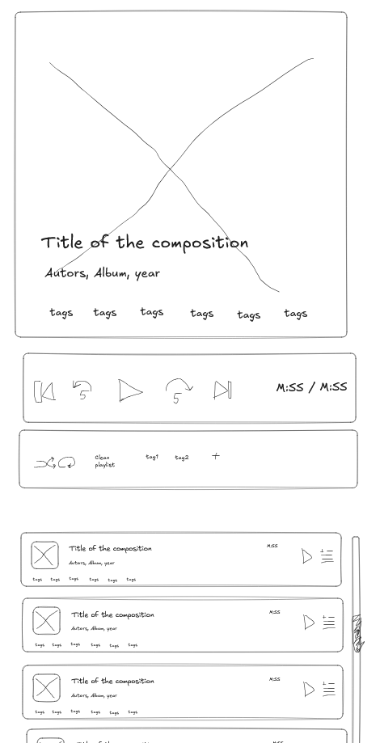

# Screens and library model

Status: web UI and the server endpoints below are implemented
(2026-10-12, `web/`, `server/`); the iOS app (`ios/`) implements the same tab flow (ADR-0007, [`../specs/ios.md`](../specs/ios.md)). The web UI is served by FastAPI from
the same origin as the API at `play.isayenko.net` (no CORS, token-protected
API), see ADR-0003 in [`../tech/decisions.md`](../tech/decisions.md). The
iOS app mirrors the web flow with Library, Playback and
Settings tabs (iOS search states: spinner, "No results", and inline errors for 401, 403 (account not allowed), unreachable and server failures, see IOS-023; Settings shows a "Custom server · Reset" row only for a non-default connection, IOS-010; Add is a sheet from the Library header; YouTube text search is a secondary screen inside it, with an opaque bottom search bar, an inner clear X (only with text) and no Cancel, back is the "<" button; Library lists the whole catalog, with a "Downloaded" toggle and four category chips that open a bottom sheet), see [`../tech/architecture.md`](../tech/architecture.md).

Scope: the web UI is for managing the library and listening online only (it saves catalog entries without audio; songs not on the server show the YouTube/SoundCloud logo as a link instead of play; only existing server audio plays),
with no offline storage or audio cache. Offline listening ("download to
device") is the iOS app: Add and Library work as below, plus downloads to
the phone, a Library over the whole catalog with the audio state per row (on the iPhone, downloadable, or no audio yet; ADR-0010, IOS-030), and the Electrophone look
([style guide](../ui-ux/style-guide.md)). iOS differences are listed in
[`../specs/ios.md`](../specs/ios.md); layouts below are the web's.

## Concept: tags replace playlists

A song has zero or more tags (free-form strings), so it belongs to
several "playlists" at once. A tag view is just a filter on the
library. There is no separate playlist entity.

## Navigation

Web (Electrophone screens, web v16 artboards, ADR-0009 amendment): four
destinations, **Library**, **Playback**, **Genres map** (`#/genres`: a movable force graph of the user's genres filling the whole page, with a translucent toolbar, a legend, a collapsible outline panel and a floating selected-genre card, GEN-010..023) and **Settings**; adding a song is the
accent "Add song" button in the Library header, which opens the Add dialog
(`#/add` still works and opens Library with the dialog). A signed-out visitor sees
only Settings (Sign in with Google, Sign in with Apple; no token field); once
signed in, Settings shows the email and Sign out. Navigation is a 220px rail
(>= 720px, collapsible to the 64px icon rail with a toggle button, WEB-037), a 64px icon rail (480-719px) or a floating tab bar (< 480px). A
persistent player bar (cover, title, shuffle, previous, play/pause, next, repeat,
time, volume) sits at the bottom of Library and Settings and opens Playback on
tap; on Playback itself it is hidden. Library is a table of the catalog
(cover, Track (title, followed by the remix and production names in muted parentheses when set (LIB-112), with a muted "Artist · Year" line below), Genres (from 900px; Track is a fixed 300px with the cover, Genres takes all remaining width), Time, a "..." menu; no #, Album, Artist or Year column; Genres drops first on narrower screens). A song without server audio is greyed, shows its YouTube or SoundCloud logo as a link and a Download icon button (fetches the audio to the server; phones use the row menu item "Download to server") next to the menu (while its audio is being fetched, a progress ring with the percent and a thin line along the row's bottom edge instead, LIB-098; a failed fetch shows a warning button that retries) instead of the time, has only "Edit song" in its menu and never enters the queue (WEB-023). Above the list, four category chips (Tags, Genres,
Years, Countries) open a multi-select filter sheet (WEB-011). Web Playback is two columns (below 900px the queue card sits under the player): the player column has the cover (title and artist on it), a seek bar, the transport tray (Shuffle, Previous, Play, Next, Repeat), a volume row and the details; the queue card beside it has "Add by tag" and "Clear" and no tab badge (the queue length shows in its header; PLY-001, PLY-002). The iOS Settings screen shows Account (a quiet "Not allowed on this server" under the email when the server answers 403), Downloads (read-only audio quality, "Download new songs automatically", "Use mobile data"), and Storage, then the version line; the iOS Add sheet opens the edit form right after Fetch (link field, Fetch and the search link hidden) and pins "Add to library" and "Add and download to iPhone" at the bottom. The iOS app has its own tab bar with the same three destinations (its Playback has no volume row and its titles carry no eyebrow) (see
[`../specs/ios.md`](../specs/ios.md)).

## Screens

### 1. Add song

Web: a centred 560px dialog over Library (bottom-aligned sheet on phones): title "Add from YouTube or SoundCloud", Cancel, a link field (YouTube or SoundCloud link, or a bare YouTube video id) with a Fetch button, then the one shared song form with a sticky "Save to library" button. The form after Fetch is the same control as the Edit dialog (WEB-033, `web/js/song-form.js`): same fields in the same order, including Get metadata, the hint and the two Wikipedia inputs; only the BPM row (Add: muted "BPM is detected after saving") and the preview header differ. After Fetch (WEB-022) the full form opens at once, with "Get metadata" and four service icons after Title and Artist, Genres and Countries chip fields (the Genres field suggests up to 6 genres as you type, WEB-030), and a sticky Save footer. A Remix & additional production field follows Artist (also in the edit dialog); Title, Artist and Remix show their text as pills split only on ' - ', ' | ' and ' / ' with spaces (commas and ampersands never split, WEB-039, ADD-071); the Title is first cleaned of promo noise with a "Cleaned: removed [Free Download] - Restore" hint (ADD-077) and offers 'Move "X" to Artist?' with 2+ pills (ADD-080); the pills show with a pencil menu and an X (WEB-028); pills can also be dragged to the other field or reordered (WEB-029, ADD-074); the Remix field is prefilled from the fetched link when the server cut a remix bracket or a title segment containing "remix" out of the title (WEB-026, IOS-063). A link already in the library is flagged under the field as soon as it is pasted ("Already in your library: title · artist", Show in library, Fetch disabled; WEB-025). The pencil menu edits, removes or moves a pill to another of the three fields (WEB-028, ADD-071, IOS-065). Saving closes the dialog and saves the catalog entry only, without audio (toast "Saved to library"; the web starts no download, WEB-015). On iOS the Add sheet opens the same form right after Fetch and pins "Add to library" (also downloads when "Download new songs automatically" is on) and "Add and download to iPhone" at the bottom; that is the only path that puts audio on the phone, and the "Downloading NN%" row appears for it. Closing the sheet by any route clears the form (IOS-020).

1. User pastes a YouTube URL or a bare 11-character video id (cleaned to the canonical link on paste, drop, bulk input and blur; surrounding text is dropped).
2. App asks the server for a metadata preview (cover, title, artist,
   album, year, and suggested `genre:` and `country:` tags from yt-dlp, MusicBrainz and Wikidata, plus suggested Wikipedia links for the song and the band).
3. User edits any field and assigns tags in the shared tag editor ("Get metadata" after Title and Artist fills empty Album and Year and suggests genres and a country, and offers a tappable "Wikipedia says: artist / title" hint under Artist when it differs (never auto-filled; a Remix & additional production field sits under Artist, IOS-063; Title, Artist and Remix fields hold pills with a pencil menu, an X, drag and drop and move, IOS-065, IOS-066); four service icons beside it (YouTube, SoundCloud, Wikipedia, Spotify) are grey by default, pulse while the request runs, and turn brand-coloured and tappable (opening the found page) for each service that returned a match; Spotify always stays grey; separate Genres and Countries fields hold the `genre:` and `country:` tags (Genres suggests up to 6 matching genres as chips while typing, IOS-067); suggested tags, existing tags grouped by prefix, `key:value` allowed; incomplete leftover text such as `mood:` is ignored).
   BPM is not entered on iOS: the form shows only the line "BPM is detected after saving" (web: optional field, detected after the download when left empty).
   Two optional inputs, Wikipedia (song) and Wikipedia (band), hold the links (shown as the article name, a bare name is accepted on the web); they are saved with the song and feed "Get metadata"; iOS shows them in the same form, side by side, with only the article name displayed (IOS-068). "Wikipedia says" is a hint, never auto-filled. There is no "Original track" field. The server normalises feat. credits to "feat." in the saved artist and title and keeps "Live" in the title.
4. Save writes the catalog entry; on iOS the app then downloads the audio through the server (IOS-022), on the web no audio is fetched.
5. Shows progress while downloading and a clear error on failure
   (bad URL, unavailable video, server unreachable, already in library).
   The Add sheet flags a link already in the library as soon as it is pasted, before Fetch (no network), with a Play action.

### 2. Library

Manages all songs.

- One row per song in a single list card (web: table with a header row, LIB-010; columns cover / Track / Genres / Time / menu, with artist and year only in the Track cell's muted "Artist · Year" line and no #, Album, Artist or Year column, LIB-018): cover, title, genres, duration and a "..." menu with Play now, Add to playlist, Download and Edit song (the Edit dialog also holds Delete; a song without server audio has only Edit song). On the web, clicking the title of a song with audio plays it and keeps the user on Library. The playing row has an accent wash. Tags are not shown in rows (filter by the category chips); BPM is a small outlined badge at the right end of the title line (LIB-019), also on Playback and in Edit. Sort is the text button under the chips ("Recently added", Title, Artist, Year, BPM); a line on the right reads "N songs match · selected values" when filtered.
- Search box (title, artist, album, tags). With a tag filter or search text active, an "Add all N to playlist" button appends all listed songs to the queue (toast "Added X songs (Y already in queue)"; a tag filter becomes a playlist chip, search-only adds are manual); hidden when nothing is filtered. A "Play all N" button next to it (always shown when songs are listed) replaces the queue with the listed songs and starts playing (toast "Playing N songs (queue replaced)"). Playback and Edit have a Download button (plain file save, WEB-034).
- Rows stretch over the whole width right of the sidebar. Each row has a playlist toggle (selected when the song is in the queue; click adds or removes, LIB-095). The bottom mini-player is a fixed 720px bar (raised surface, border, shadow) with Edit details, Show in list (scrolls to and flashes the playing song's row, LIB-097) and Add to current playlist (toggle, PLY-119).
- `decade:` tags are derived from Year by the server and show as "the 90s"; the tag editor previews the chip as Year changes.
- Filter by tag (chips grouped by prefix: Genre, Decade, Country, then others; plain tags under Tags; `country:` values show as names, e.g. Lithuania; languages are not shown or filterable); sort (added date, title, artist, year, BPM; songs without BPM last).
- The iOS song sheet and the Add form share one form (`SongFormView`, IOS-070): same fields in the same order (Album and Year, and the two Wikipedia fields, side by side), Get metadata, service icons and both Wikipedia link fields; only the BPM row differs. The song sheet has the same separate Genres and Countries fields as Add; its generic tag editor hides `genre:`, `country:` and `lang:` tags.
- Edit dialog is the same shared form as Add (WEB-033): Title, Artist, Remix (all pills, WEB-039), hint, "Get metadata" with service icons (fills only empty fields), Album, Year, Genres, Countries, the two Wikipedia inputs (always visible), uses the same tag editor and shows BPM as a read-only label ("128 BPM" or "Not detected yet") with a Re-detect button (re-runs detection on the stored file).
- Edit metadata and tags of a song; Delete a song (server file, cover and
  record) from the Edit dialog.

### 3. Player (Playback tab)

Web updates (2026-10-14): the song-details card has no "..." menu, only two round icon buttons, Download (hidden when the song has no server audio) and Edit song (PLY-072, PLY-102); the cover is a play/pause button with a translucent icon overlay (PLY-016); the queue "Clear" button drops every upcoming song and all chips and is disabled with a tooltip when there is nothing to clear (PLY-034); with Settings > Playback > "Auto-download songs" on, songs without audio can be queued and show Queued / Downloading N% / limit-pause / Failed-Retry states in the queue and in a banner under the cover, off shows "Not downloaded" with a Download button (PLY-110..116).

SUPERSEDED for the web by the two-column layout in Navigation above (PLY-001); the four-block layout below is the older design, kept for reference only.

Four stacked blocks in a centered column (max 720px). The page itself does
not scroll; block 4 takes the remaining height and scrolls inside.

```
+--------------------------------------------+
| 1. SONG DETAILS                            |
|  large cover fills the card                |
|                                            |
|  ......................................    |
|  Title of the composition   (on a scrim)   |
|  Author, Album, year                       |
|  [tag] [tag] ...  BPM  Source Wikipedia(s) |
+--------------------------------------------+
| 2. SONG PLAY CONTROLS                      |
|  |<   (<5)   [ > ]   (5>)   >|    1:05 / 3:33
|  ---o------------------------ (thin scrub; drag, click, arrow keys: PLY-120..122) |
+--------------------------------------------+
| 3. PLAYLIST CONTROLS                       |
|  [shuffle] [loop 1] [loop all]
|  (tag1 x) (tag2 x)  [+]         N songs    |
+--------------------------------------------+
| 4. CURRENT PLAYLIST          (scrolls) |###|
|  [cover] Title              M:SS  [>] [=]  |
|          Author, Album, year               |
|          [tags ...]                        |
|  [cover] ... (current row highlighted)     |
|  ...                                       |
+--------------------------------------------+
```

Wireframes (`wireframes/`): current is the detailed v3
([whole screen](wireframes/playback-v3-detailed.png),
[controls](wireframes/playback-v3-controls.png),
[rows](wireframes/playback-v3-rows.png),
[scrollbar](wireframes/playback-v3-scrollbar.png)); the row mirrors the
Library card ([`library-row.png`](wireframes/library-row.png)). Earlier
drafts, both SUPERSEDED:
[v1 three blocks](wireframes/playback-v1-three-blocks.png),
[v2 four blocks](wireframes/playback-v2-four-blocks.png).



1. **Song details**: the cover fills the whole card (placeholder colour when
   there is none); title, "Author, Album, year", tag chips, BPM and up to three
   links (new tab) are overlaid at the bottom on a dark gradient
   scrim (legible in light and dark). Links: Source (`source_url`), Wikipedia (song) and Wikipedia (band) (`wikipedia_song`, `wikipedia_artist`); each shows only when set. Empty: "Nothing playing".
2. **Song play controls**, one row: previous song, back 5 s, play/pause
   (also space), forward 5 s, next song, and "M:SS / M:SS" on the right. A
   thin scrubber under the row keeps seeking possible. No volume slider
   (device volume is used).
3. **Playlist controls**, one row (wraps on narrow screens):
   - Shuffle toggle (`aria-pressed`).
   - Loop one song toggle and loop whole list toggle, mutually exclusive
     (turning one on turns the other off; both off = stop at the end).
   - The queue card header (not this row) has **Add by tag** and **Clear**: Clear
     removes every upcoming song and all tag chips; the current and played
     songs stay (PLY-034).
   - Chips = the currently selected tags, each with an x; **+** opens the tag
     picker; song count on the right.
4. **Current playlist**: rows look like Library cards (cover, title,
   "Author, Album, year", duration, play button, tags line) plus a menu
   button (Edit song, Download when the song has server audio, Move up, Move
   down, Remove; PLY-042). Tap a row to play it; the current
   song is highlighted. The list has a persistent, slim, styled scrollbar
   ([wireframe](wireframes/playback-v3-scrollbar.png)). Empty: "Queue is
   empty - add songs from Library".

#### Queue and tag rules

- The queue is the "current playlist", client-side only (`localStorage`,
  restored on reload without auto-play; songs deleted from the library are
  dropped). Each item records `manual` (added one by one) and the tags that
  brought it in.
  - Play now: inserts the song right after the current one and plays it; if
    already queued it is moved there. It counts as manual.
  - Add (Library): appends to the end; a manual duplicate is ignored (toast
    "Already in queue"). A song already queued only via a tag becomes manual.
    If the queue was empty the song is queued but not played.
  - Move/Remove apply to every row, played and current included; the current
    song stays current (followed by identity). Removing the current song
    plays the next playable one, or stops when none is left (PLY-046).
- **Tag picker** (+): all tags grouped by prefix with counts, multi-select;
  already selected tags show as selected. Confirming adds every song that has
  ANY picked tag (union) to the end of the queue, dedupes, and shows the
  picked tags as chips. Deselecting a selected tag in the picker removes it
  like the chip's x.
- **Removing a tag** (chip x) removes the
  songs it contributed only if they are upcoming (after the current song),
  not manual, and not held by another remaining chip. The current song keeps
  playing; played songs and songs added manually stay. Manual wins if a song
  is both manual and tag-derived.
- **Order of play**: sequential by default. Shuffle on: next picks a random
  song not yet played in this round; when all have played it stops, or with
  loop whole list reshuffles; previous walks back through the songs actually
  played. Shuffle off restores sequential order from the current song.
  Loop one song replays the current song when it ends (the Next button still
  advances). Loop whole list wraps from the last song to the first. Shuffle
  and loop state persist in `localStorage`. The logic is pure and tested:
  `web/js/queue-logic.js`, `node web/js/queue-logic.test.mjs`.
- Player bar over Library and Settings with short controls; tap
  opens Playback. Web Playback has no 5-second skip keys (Left/Right arrow keys seek 5 s); the repeat key cycles off, whole list, one song; the favourite button of the artboard is not built (no such feature).

## Song fields

| Field | Key | Notes |
| --- | --- | --- |
| Author | `artist` | editable |
| Composition name | `title` | editable |
| Album | `album` | editable, optional |
| Year of release | `year` | editable, optional |
| Tempo | `bpm` | whole number 20-300, or `null`; auto-detected with aubio on add, editable, heuristic (ADR-0002) |
| Source URL | `source_url` | where it was downloaded from |
| Wikipedia (song) | `wikipedia_song` | optional Wikipedia/Wikidata link, editable |
| Wikipedia (band) | `wikipedia_artist` | optional, same rule |
| Cover image | `cover` | jpg file, see below |
| Tags | `tags[]` | plain or namespaced `key:value` strings (`genre:<name>`, `country:<code>`, `lang:<code>`) |
| Id | `id` | YouTube video id (technical) |
| Duration | `duration` | seconds (technical) |
| Added at | `added_at` | ISO 8601 UTC (technical) |

## `library.json` record

```json
{
  "settings": {
    "music_root": "perkunas://data/music/"
  },
  "songs": [
    {
      "id": "dQw4w9WgXcQ",
      "file": "dQw4w9WgXcQ.m4a",
      "title": "Never Gonna Give You Up",
      "artist": "Rick Astley",
      "album": "Whenever You Need Somebody",
      "year": 1987,
      "bpm": 113,
      "source_url": "https://www.youtube.com/watch?v=dQw4w9WgXcQ",
      "wikipedia_song": "https://en.wikipedia.org/wiki/Never_Gonna_Give_You_Up",
      "wikipedia_artist": "https://en.wikipedia.org/wiki/Rick_Astley",
      "cover": "covers/dQw4w9WgXcQ.jpg",
      "duration": 213,
      "added_at": "2026-10-12T09:30:00Z",
      "tags": ["80s", "workout", "genre:pop", "mood:chill"]
    }
  ]
}
```

- `settings.music_root` (implemented, ADR-0005): `<servername>://<path>/`,
  the one place that says where audio lives. Songs reference audio only
  by relative `file` name (`<video_id>.m4a`); moving the music to another
  host or path means changing this one value. The server resolves
  `<servername>` via its own local config (name -> mount path/host,
  outside the repo), so the JSON holds no credentials or IPs.
- An old bare `{songs:[...]}` file is migrated on load; `AUDIO_DOWNLOAD_DIR`
  is only the fallback when no `music_root` is set. `AUDIO_MUSIC_ROOT`
  overrides it locally.
- ~~Today audio is at `downloads/<id>.m4a` on the server.~~ Per user since ADR-0012: `<music_root>/users/<uid>/<id>.m4a`. Covers are
  `covers/<id>.jpg` (downloaded from the yt-dlp thumbnail at save time).
- Storage (ADR-0005, implemented; plain files when `AUDIO_DATA_REPO` is unset):
  `library.json` is `audioplayer/library.json` in the git repo
  `alexisayenko/data-storage`, covers are `audioplayer/covers/<id>.jpg`
  in `alexisayenko/data-storage-lfs`; every change is a commit. Keep
  secrets and personal data out of the file, history is permanent.
- Optional fields may be `null`. Tags are trimmed and deduplicated
  case-insensitively; `key:value` tags are stored lowercased, plain tags
  keep their case; a half-empty `key:` or `:value` is dropped. There is no `genre` field: an old `genre` value is
  migrated on load to the tag `genre:<value>`.
- Storage rules (atomic writes, single writer, no SQLite, git-backed
  store) are in
  [`../tech/decisions.md`](../tech/decisions.md).

## API surface the screens need

Implemented. The web UI uses only the session cookie; the iOS app uses Google or Apple sign-in (Bearer ID token; a legacy saved token is still sent until Reset, IOS-011) and the owner's scripts use `X-API-Token` (header), except that `/files/{id}`
and `/covers/{id}` also accept `?token=` because `<audio>` and ``
cannot send headers. The static web UI files at `/` are public; they
contain no data.

| Endpoint | Purpose | Screen |
| --- | --- | --- |
| `GET /library` | all songs, with tags | Library, Player |
| `POST /preview {url}` | yt-dlp metadata, no download | Add |
| `POST /songs {url, metadata, tags}` | save metadata and start download | Add |
| `GET /songs/{id}/status` | download progress or error | Add |
| `PATCH /songs/{id}` | update metadata, tags, `bpm` (20-300 or `null`) | Library |
| `POST /songs/{id}/bpm/detect` | re-detect BPM from the stored file, returns the song (422 if undetectable) | Library |
| `DELETE /songs/{id}` | remove record, audio, cover | Library |
| `GET /files/{id}` | stream m4a (Range supported) | Player |
| `GET /covers/{id}` | cover image | all |
| `GET /tags` | known tags with counts | Add, Library |
| `GET /catalog` | the whole catalog with ETag (iOS Library sync, IOS-035) | Library |
| `GET /genres` | known genres for the Genres suggestions (IOS-067) | Add, Library |
| `POST /metadata` | Get metadata: album, year, genre and country tags, Wikipedia hint, services | Add, Library |

`POST /songs` returns 202 and downloads in the background; poll
`GET /songs/{id}/status` (`downloading` with `progress` 0..1, `done`, or
`error` with a message). The record is written to `library.json` only
when the download succeeds, so the library lists playable songs only.
Duplicates return 409. BPM detection runs after the file is saved; if it fails the song is saved with `bpm: null`. Old records without `bpm` load fine. If the cover fetch fails the song is still saved
with `cover: null`. `POST /download` and `GET /search` still exist for the
iOS secondary text search; the web UI does not use them.

## Open questions

- (Resolved for iOS) `/search` stays as a secondary text search under Add;
  the web UI is paste-only. Open: the row download there still uses the
  legacy `/download` (API-018).
- (Resolved) The web UI mirrors all three screens: Add, Library, Player
  (the Playback tab, also opened from the persistent mini-player bar).
