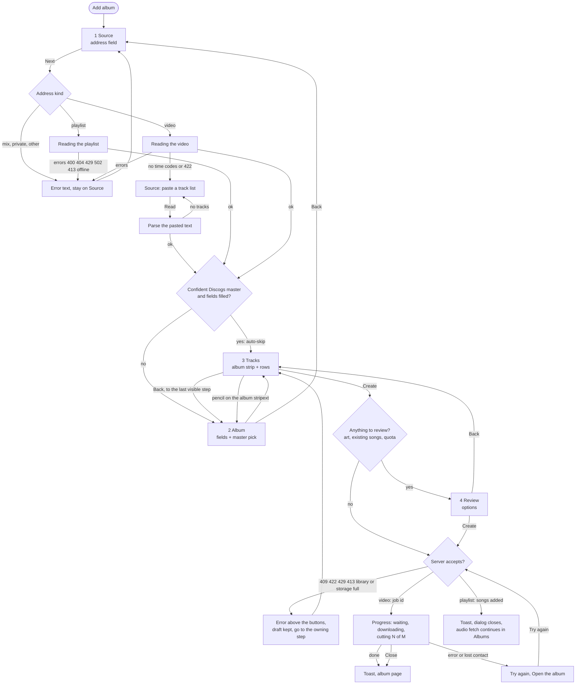

# Add album as a light wizard (design proposal)

Status: PROPOSAL, 2026-10-27. Nothing is built. Docs only. Related: [task-0120](../tasks/task-0120.md) (albums), [task-0038](../tasks/task-0038.md) phase 1B (album from a time-coded video), [ADR-0050](../tech/decisions.md) (Album entity), [screen-flow.md](screen-flow.md) section 4.3 (the flows as built), [ux-preferences.md](../product/ux-preferences.md) (rules this proposal obeys).

## Scope decided by Alex

Add album accepts ONLY:

1. a YouTube playlist link;
2. a time-coded YouTube video link (chapters or description). A video without time codes keeps the paste-a-track-list fallback (including the lengths-only list, LIB-261).

Discogs stays as a metadata filler (year, type, genres, cover, link) with one row per Discogs master. The Discogs-link input mode is removed; another agent is removing it and adding the master picker in `web/js/albums*.js` right now. This document is written against `origin/main` as of 2026-10-27 (commit e87f563c); line references may move when that work lands.

## 1. The flow as it is in code

One shared dialog (`#add-dialog`, `openAddAlbum` in `web/js/albums.js`). Three screens, one scrolling card.

| Stage | What happens | Code |
| --- | --- | --- |
| A. Address | One field, "Fetch". Routes by address kind: `mix` or `private` playlist = error text; playlist = playlist flow; video = video flow; anything else = the Discogs release preview (being removed). | `albums.js` `openAddAlbum`, `playlist-link.js` |
| B. Draft | One long card, built by `mountAlbumDraft`: head (title, uploader, source note), "Matched on Discogs" line, cover, album fields (Title, Artists, Year, Type, Genres, Links with "Suggest links"), "Find on Discogs", summary bar + "Select all/none", track rows, bottom buttons (Add a track, Use album artist for all, Sort, Paste a track list, "Paste a track list instead"), problems line, footnote, Back + Create. | `album-draft-view.js`, `album-form.js`, `album-discogs.js` |
| C. Progress | Video only: "Creating the album" with a bar, polled every 1.5 s. Playlist: dialog closes at once, toast, audio is fetched client-paced by the Albums view. | `album-video-progress.js`, `albums-youtube.js` |

Flow differences inside stage B:

- Video: start times (editable), "Open in YouTube at this time", "Use existing" for tracks already in the library, sort, add a track, paste a list instead, lengths-only list with "Scale to video length", warnings (overlaps, gaps, total mismatch). One download, one ffmpeg split job, counts as ONE add (20 an hour limit, ADR-0012).
- Playlist: one row per video, YouTube icon, "In library" chip for videos already owned (linked, not added twice), no times. Creating adds the songs at once (metadata only); audio is fetched by the client one at a time, up to 20 an hour, paused on `hourly_limit`.

Hidden decisions the user takes without being told:

- The album fields are pre-filled by a server guess (title pattern "Artist - Album (year) [FULL ALBUM]", channel as artist only if the title has no "Artist - " part) and by an automatic Discogs match that is applied silently (the one exact master). The user sees only a small "Matched on Discogs: link" line; there is no way to see the alternatives except the manual "Find on Discogs".
- Which tracks become songs (ticks) and which reuse an existing song ("Use existing", default on).
- Album art: the cover is the Discogs image or the video thumbnail, chosen by the server. Copying it onto the songs ("Use for songs") exists only later, in the Edit album dialog.
- For videos, the last track always ends at the video duration; fades are no longer sent.

Pain points:

1. Length. Cover, fields, Links and the Discogs finder sit above the track list, so on a 375 px phone the tracks start several screens down, while the Create button is at the very bottom. The summary bar and problems line are far from the field that causes them.
2. Three separate jobs (check the album, check the tracks, decide and create) are one undifferentiated page, so the order of work is unclear. The user must know to look at the Matched line.
3. State is lost on Back: Back from the draft returns to the empty address field and discards edits (`body.replaceChildren()`); only the typed address survives.
4. The two flows are wired through a callback bag (`hideForm`, `showForm`, `onBack`, `setBusy`, `say`) that reaches back into the address form. Adding a step means touching every callback.
5. The progress stage cannot be cancelled and, when the dialog is closed, polling stops while the job keeps running (the server has no cancel). The user gets no explanation of this.
6. Errors are good but local: `say()` writes one `role="alert"` line above the body, which can be off-screen while the user is at the bottom pressing Create.
7. No explicit offline branch: a failed fetch falls to the generic `ex.message`.

## 2. Proposed light wizard

Principle: the wizard changes only how the existing screens are arranged and sequenced. Same server calls, same payloads, same dialog shell (`dialogHead`, `backdropClose`), same tokens and classes. It is light: three visible steps, steps that have nothing to ask are skipped, and everything the user typed survives Back.

### 2.1 Steps

| # | Step | Purpose | Contents |
| --- | --- | --- | --- |
| 1 | Source | Get the track source | Address field, kind detection, "Reading the playlist/video...", errors; for a video with no time codes, the paste panel is part of this step ("No track list was found. Paste it below."). Next = "Read" (calls preview). |
| 2 | Album | Identify the release | Album fields (Title, Artists on separate lines, Year, Type, Genres, Links with Suggest links), cover, Discogs master pick (one row per master). |
| 3 | Tracks | Fix the track list | Rows (artist, title, version, start time for video), link existing songs, summary, paste fallback, add/remove/sort. Footer: Create (or Next when a Review step is needed, 2.4). |
| 4 | Create | Review (only when needed), then run | Options and conflicts, then the split progress (video) or the result (playlist). |

The step indicator is one line of text, "Step 2 of 3 · Album", plus dots; it never counts skipped steps (2.2) and never counts Review unless it is shown.

### 2.2 Auto-skip rules

A step is skipped only when the user has nothing to decide AND can still reach it.

- Source: never skipped; but when the dialog is opened with an address already known (a future "Add album" from a pasted link elsewhere), the address is prefilled and Next runs at once.
- Album: skipped when ALL hold: the preview carries a Discogs auto-match (a single master that equals the guessed artist and title exactly, the existing `auto_match` rule, year within 1 of the guessed year when a year was guessed), the title and artist fields are non-empty, and the preview has no warning on the album fields. Otherwise shown. Zero candidates and no confident guess: shown, with the fields empty and the status line "No match on Discogs. Fill the album by hand." Several candidates, none exact: shown with the master list expanded.
- A skipped Album step is not hidden: Tracks starts with a one-line album strip (cover thumbnail, "Artist - Title · year · type", "Matched on Discogs", a pencil icon). The pencil returns to the Album step (state intact). This keeps the "silent match" visible, which fixes hidden decision 1 above.
- Tracks: never skipped (the user must see what will be created). It is the only mandatory review.
- Review (inside Create): shown only when there is something to choose or confirm: tracks marked "Use existing", an album art option available, a quota warning, a mix of unlinkable tracks. Otherwise Create on the Tracks footer starts the job directly.

### 2.3 Back and Next semantics

- Next validates the CURRENT step only; Back never validates and never loses data.
- Next on Source calls the preview (`albumVideoPreview` / `albumYoutubePreview`). If the address string is unchanged since the last successful preview, it reuses the stored preview, no network call.
- If the address changed after the user edited downstream (fields or rows), Next asks one inline question: "Start over from this link? Your edits to the album and tracks will be replaced." Two buttons; the same two-click confirm already used by the track-list panel.
- Back from Album or Tracks goes to the previous VISIBLE step; a skipped step is stepped over in both directions.
- Back from Source closes nothing; Esc or the close icon closes the dialog. A dirty draft asks before the backdrop closes it (existing `backdropClose` dirty rule).
- During Create progress there is no Back and no Next; there is "Close" (see 2.7).
- Enter in a single-line field of Source = Next (the field is a form). Enter in a row field ends the row edit (existing), not the step.

### 2.4 State kept across Back

One draft object, owned by the wizard shell, created when the dialog opens:

```text
draft = {
  address, kind,                // source step
  preview, rawText,             // last preview response and pasted text
  album: { title, albumArtist, year, type, genres, links, coverUrl, discogsMatch },
  rows: [ { include, artists, title, version, start, useExisting, editing } ],
  candidates, picked,           // Discogs master list and the pick
  options: { artForSongs },     // Review choices
  step, skipped: { album: bool }
}
```

Steps render from the draft and write back to it on input, as `syncAlbum` and the row `input` handlers already do. Leaving a step keeps its DOM state only through the draft (no hidden DOM kept alive), so a re-render never loses text, scroll position is restored per step, and the focused field is restored.

Invalidation: a new preview replaces `preview`, `rows` and `album` only after the "Start over" confirm. Edits to Year/Type/Genres never refetch anything. Choosing a Discogs master fills Year, Type, Genres, Links.discogs and the cover and never overwrites a field the user changed after the last auto-fill (mark such fields dirty; today `pick` overwrites year, type and the link unconditionally, so this is a small behaviour change, listed in section 5).

### 2.5 Empty and error states

Messages reuse the existing strings (`previewErrorText`, `youtubeErrorText`, `createErrorText`, `fetchErrorText`). Where each shows:

| Situation | Where | Text and action |
| --- | --- | --- |
| Empty address | Source | "Paste a YouTube playlist or video address." Next stays enabled so the message is reachable; focus returns to the field. |
| Mix or private playlist | Source | existing `MIX_MESSAGE`, `PRIVATE_MESSAGE`; stays on Source. |
| Not a YouTube link (including a Discogs link, after the mode is removed) | Source | "Add album takes a YouTube playlist or a video with time codes. Paste one of those." A Discogs link gets one extra line: "Discogs fills the details after you add the YouTube link." |
| 400, 404, 429, 502 on preview | Source | existing texts; stays on Source, field and address kept. |
| 413 (too long, too many tracks) | Source | the server's detail text. |
| Video without time codes (no tracks or 422) | Source, paste panel | "No track list was found in this video. Paste it below." Read keeps the pasted text on failure. |
| Pasted text yields no tracks | Source, paste panel | "No tracks found in this text. Each line needs a time, like 03:45 Artist - Title." (A lengths-only list is accepted in Tracks, LIB-261.) |
| Playlist with zero available videos | Source | "This playlist has no playable videos." (to add; today an empty table). |
| Discogs not configured or unreachable | Album | inline in the master list: "Discogs search is not set up on this server." or "Discogs could not be reached. Try again later." The step still allows manual fields. |
| No Discogs match | Album | "No match on Discogs. Fill the album by hand." |
| Track issues (empty title, overlap, bad time) | Tracks | per row flag + the first problem in the summary line (existing `issues`); Create disabled. A row problem scrolls the row into view when Create is pressed. |
| Offline (`navigator.onLine === false` or a network failure with no status) | Source, Create | "You are offline. Adding an album needs the server." Next/Create disabled until the `online` event; a thrown fetch without a status maps to the same text. Nothing is lost (the draft is local). |
| Library full: `library_full_songs`, `library_full_bytes` | Tracks footer | "Your library is full..." / "Your storage is full..."; table stays editable; the playlist and video previews already check the limits up front, so this is shown at step 1 for the preview (413 path) and again at Create if a concurrent add filled it. |
| Hourly limit (429) | Create | "Hourly limit reached. Try again later." with the time when the server gives it; Create stays enabled; the draft is kept. |
| Album limit, album already exists (409) | Create | "You have reached the album limit..." or "This album already exists." with "Open it" (existing). |
| Song marked Use existing was deleted (404 `unknown_song`) | Create | existing text; returns to Tracks with that row's "Use existing" cleared. |
| 422 bad times, bad tracks, no tracks, bad album | Create | existing `CREATE_422` text; returns to the step that owns the problem (times and tracks: Tracks; bad album: Album). |

Errors are shown in a `role="alert"` region directly above the footer buttons of the current step (not above the whole body), so they are always on screen next to the button that caused them.

### 2.6 Review options (step 4, only when needed)

- "Use the album art for the songs" (checkbox, default off). Only shown when the album will have its own cover (a Discogs image or the video thumbnail). It runs `POST /albums/{id}/cover/to-songs` with `overwrite: false` right after create succeeds (the same call as the Edit dialog's "Use for songs"); a song cover the user chose is kept. Needs the linked songs to exist, which holds for both flows (the commit creates the songs). Failure here never fails the album: toast "Album created. Art could not be applied to the songs." with a retry in the Edit dialog.
- "Use existing songs" summary line: "3 tracks reuse songs already in your library" with a link back to Tracks.
- Quota line (playlist): "12 tracks, up to 20 fetches an hour, it pauses and resumes." (existing).
- Video note: "The whole split counts as one add."

If none of these apply the step is not shown and Create sits in the Tracks footer.

### 2.7 Progress for the split job (video)

The Create step turns into the existing progress card: title "Creating the album", a determinate bar (`role="progressbar"`, label "Split progress") and one status line: "Waiting for the server to start." / "Downloading the video audio." / "Cutting 3 of 10 tracks: Title." No time estimate is shown (the server does not give one). Changes against today:

- A "Close" button (icon, with a visible label on the phone) is available at all times with the note "You can close this. The split continues on the server." Closing stops polling, shows the toast, and opens the album page (it already exists after commit). The album page then needs to show a running split; today it does not (to verify against `video_split.py` job lookup and the album page; if missing it is a prerequisite or a documented limitation).
- No Cancel (the server has none). The wizard does not invent one.
- Failure keeps "Try again" and "Open the album"; loss of contact (4 failed polls) keeps its text. "Try again" resubmits; the server reuses an active job for the same video, so it does not start a second split.
- Playlist: no progress card. The dialog shows "Album created, N songs added" and closes with the toast as today; the paced audio fetch continues in the Albums view with its own "Paused: hourly limit" line.

### 2.8 Keyboard and accessibility

- The dialog keeps its native `<dialog>` focus trap, Esc to close (Esc inside a row edit closes only that edit, existing).
- On a step change focus moves to the step heading (`tabindex="-1"`), and a polite live region announces "Step 2 of 3: Album". The indicator uses text, not colour alone; the current step has `aria-current="step"`.
- Tab order inside a step is document order; Back and Next are the last two controls; Next is the default action of the step form (Enter).
- Disabled Next/Create state has a visible reason in the problems line (existing pattern), not only a greyed button; `aria-disabled` plus text rather than silent `disabled` where the reason matters.
- Rows keep their labels ("Start of track 3", "Include track 3"); the master list is a radio group (arrow keys, one tab stop) with `aria-label="Discogs masters"`.
- Icon buttons keep tooltip + `aria-label` (ux-preferences); Back/Next/Create keep short text labels since they are primary actions.
- Reduced motion: no step transition animation beyond the existing dialog fade.
- Pointer: all hit targets use `--hit`; hover affordances do not move content.

### 2.9 Mobile web widths

Breakpoints are the existing ones (719 and 479 px in `albums.css`).

- At 479 px and below the dialog is a full-height sheet: header (title, "Step n of m", close), scrolling body, and a STICKY footer with Back and Next/Create. The footer is the fix for pain point 1: the primary action is always on screen.
- Tracks use the two-line row rule from ux-preferences (line 1 checkbox, number, label, icons; line 2 Artist, Title, Version, Start, shown on demand by the pencil).
- The Album step stacks Title, Artists, then Year + Type on one line (narrow year), Genres, collapsed Links (advanced stays collapsed), cover small on top.
- The summary bar stays directly above the first row (ux-preferences: a summary bar sits next to what it summarises); "Select all/none" at its right.
- No horizontal scroll at 375 px; long names wrap (`overflow-wrap: anywhere`, as `.album-cand-title`).

## 3. Step map and wireframes

### 3.1 Flowchart



### 3.2 Wireframes

Low fidelity, tokens and existing classes only. `[ ]` button, `( )` icon button, `[x]` checked, `...` omitted.

Step 1, Source (desktop dialog, about 560 px; the phone is the same without the side margins)

```text
+--------------------------------------------------+
| Add album                                    (x) |
| Step 1 of 3 . Source                  o  .  .    |
+--------------------------------------------------+
| YouTube playlist or video with time codes        |
| +-------------------------------------+ (x)      |
| | https://www.youtube.com/watch?v=... |          |
| +-------------------------------------+          |
| Playlist: one track per video.                   |
| Video: tracks come from its chapters or          |
| description.                                     |
|                                                  |
| ! error text goes here (role=alert)              |
+--------------------------------------------------+
|                                        [ Next ]  |
+--------------------------------------------------+
```

Step 1b, video without time codes (paste panel replaces the hint)

```text
| No track list was found in this video.           |
| Paste it below.                                  |
| +--------------------------------------------+   |
| | 00:00 Artist - Title                       |   |
| | 03:45 Artist - Title                       |   |
| +--------------------------------------------+   |
| Lengths only also work: "1 Title 9:18".          |
| ! No tracks found in this text...                |
+--------------------------------------------------+
| [ Back ]                       [ Read the list ] |
```

Step 2, Album

```text
+--------------------------------------------------+
| Add album                                    (x) |
| Step 2 of 3 . Album                   .  o  .    |
+--------------------------------------------------+
| +------+  Album title                            |
| |cover |  [ For All Mankind                  x ] |
| | 96px |  Album artists                          |
| +------+  [ Astral Projection                x ] |
| [ Year 2025 ] [ Type: Album v ]                  |
| Genres  [psytrance x] [goa x] [+]                |
| > Links                              (suggest)   |
|                                                  |
| Discogs                                          |
|  ( ) Astral Projection - For All Mankind  2025   |
|      master . 12 tracks . 3 releases      [pick] |
|  (o) Astral Projection - For All Mankind  2024   |
|  ( ) None of these                               |
| Fills year, type, genres, link and cover.        |
+--------------------------------------------------+
| [ Back ]                              [ Next ]   |
+--------------------------------------------------+
```

Step 3, Tracks (video; the album strip is the skipped Album step)

```text
+--------------------------------------------------+
| Add album                                    (x) |
| Step 3 of 3 . Tracks                  .  .  o    |
+--------------------------------------------------+
| [c] Astral Projection - For All Mankind          |
|     2025 . Album . Matched on Discogs     (edit)|
+--------------------------------------------------+
| 10 of 10 tracks . 1:19:54            Select none |
| [x] 1. Artist - Title [Remix] (9:18)    ( )( )(x)|
|     In library  [x] Use existing                 |
| [x] 2. Artist - Title (8:25)  !         ( )( )(x)|
|     Starts before the previous track ends.       |
| ...                                              |
| [+ Add a track] [Use album artist for all]       |
| [Sort by start time] > Paste a track list        |
| ! first problem (role=alert)                     |
| Tick the tracks to create. One add for the split.|
+--------------------------------------------------+
| [ Back ]                    [ + Create album ]   |
+--------------------------------------------------+
```

Step 3, Tracks (playlist rows differ: no time, video icon, "In library" chip)

```text
| 12 of 12 tracks                      Select none |
| [x] 1. Title (4:12)                    (yt)(x)   |
| [x] 2. Title (5:01)  In library        (yt)(x)   |
| ...                                              |
| 12 selected, up to 20 fetches an hour, it pauses |
|                  [ + Create album, download 12 ] |
```

Step 4, Review (only when needed)

```text
+--------------------------------------------------+
| Step 4 of 4 . Review                             |
+--------------------------------------------------+
| Astral Projection - For All Mankind (2025)       |
| 10 tracks to create, 2 reuse songs in your       |
| library (change)                                 |
| [ ] Use the album art for the songs              |
|     Songs you gave their own art keep it.        |
| The split counts as one add.                     |
+--------------------------------------------------+
| [ Back ]                    [ + Create album ]   |
```

Progress (video)

```text
+--------------------------------------------------+
| Creating the album                           (x) |
| [=========-----------------------]  40%          |
| Cutting 4 of 10 tracks: Title                    |
| You can close this. The split continues on the   |
| server.                                          |
|                                          [Close] |
+--------------------------------------------------+
| error: ! text   [ Try again ] [ Open the album ] |
```

Phone (375 px), Tracks

```text
+--------------------------+
| Add album            (x) |
| Step 3 of 3 . Tracks     |
+--------------------------+
| [c] Artist - Album  (ed) |
| 10 of 10 . 1:19  Sel.none|
| [x] 1. Artist - Title    |
|     (9:18)   ( )( )(x)   |
|     In library [x] Use   |
| [x] 2. ...               |
|  (scrolls)               |
+--------------------------+
| [ Back ]  [ Create ]     |  <- sticky
+--------------------------+
```

## 4. iOS later

iOS has no Add album today (the Albums grid, album screen and Download album exist, IOS-098 to IOS-110; Add album is "missing" in task-0120 phase 4). Editing `ios/` needs Alex's permission. The wizard is also the right shape for iOS because the draft page is too long for a phone.

- Container: a SwiftUI sheet (`.presentationDetents([.large])`) holding a `NavigationStack` whose path is an enum `AddAlbumStep { source, album, tracks, review, progress }`; Back is the system back button, Next/Create is a bottom bar via `.safeAreaInset(edge: .bottom)`.
- State: one `@Observable AddAlbumDraft` (the same fields as the web draft, 2.4), held by the sheet so Back keeps everything.
- Steps map 1:1; auto-skip rules are a pure function `nextStep(from:draft)` shared by unit tests, mirroring the web's `album-wizard-model.js`.
- Networking: new `ServerLink` calls for the same endpoints (`POST /albums/video/preview`, `/preview-text`, `/albums/youtube/preview`, `/commit`, `POST /albums/from-video`, `GET /jobs/{id}`, discogs search, `cover/to-songs`) and `ios_contract.json` extended (task-0120 phase 4 already lists this).
- Source: keyboard `.URL`, paste button; the track editor uses the shared song form's Title/Artist/Remix pills (ux-preferences: one component everywhere), start time as a wheel or a text field.
- Progress: a card in the sheet for video; the sheet can be dismissed ("Close") and the album screen shows the running job. Playlist: after Create the existing client-paced `AlbumDownloader` takes over (it already pauses on the hourly limit) and the album screen shows its run card.
- Offline: signed-out and offline show the same text as the web; Add album requires the server and a sign-in (A7 in task-0120), unlike the local-only song add.
- Effort: L (new screens, models, contract, tests, device check). Needs a real build and a device run; not run on a device so far for any album flow.

The macOS app gets Albums later through the shared SwiftUI; the same sheet works as a macOS sheet.

## 5. What changes in code (web)

Reuse unchanged: `album-form.js` (`albumFields`), `album-discogs.js` (master picker, from the other agent), `album-draft-model.js`, `album-video-model.js`, `album-youtube-model.js`, `album-tracklist.js` and `album-tracklist-panel.js`, `album-video-progress.js`, `album-candidates.js` (error texts), `dialogHead`, `backdropClose`, all server calls, all payload builders.

Split:

- `album-draft-view.js` (`mountAlbumDraft`, about 170 lines, one render function) into two renderers that both take the draft: `albumSection(draft)` (head strip, cover, fields, Discogs) and `tracksSection(draft, hooks)` (summary bar, rows, bottom buttons, problems). `hooks` objects of `album-video.js` and `album-youtube-flow.js` stay.
- `album-video.js` and `album-youtube-flow.js` shrink to "how to get tracks" (preview, paste, hooks, `submit` payload); the callbacks `hideForm`, `showForm`, `onBack`, `setBusy` go away.
- `openAddAlbum` in `albums.js` (about 110 lines) becomes a thin opener of the wizard (the file is already 952 lines; moving it out also brings it under size).

New (small):

- `album-wizard-model.js`: pure step machine (`nextVisible`, `prevVisible`, skip rules, invalidation, `needsReview`), unit-tested without DOM.
- `album-wizard.js`: shell (header, step indicator, footer, focus and live region, offline listener, draft ownership).
- `album-wizard-source.js`: address step including the paste panel (extracted from `album-video.js` `showPaste`).
- `album-wizard-create.js`: review and progress (wraps `mountSplitProgress`, adds Close).
- CSS in `albums.css`: step header, sticky footer at 479 px and below, album strip; tokens only (`--space-*`, `--hit`, existing `.btn`, `.chip`, `.card`, `t-*` classes).

Behaviour changes to call out: Discogs pick no longer overwrites fields the user edited; Back keeps state; Close during progress; the offline branch; a playlist with no videos message.

Tests:

- New: `album-wizard-model.test.mjs` (skip rules, Back/Next across skipped steps, invalidation, review needed or not); wizard DOM test for focus/announcement and state kept across Back; offline text; the Close-during-progress path.
- Rewrite: the `openAddAlbum` setups in `albums.test.mjs`, `album-video.test.mjs` (lines near 62 and 366), `albums-youtube-contract.test.mjs`, `albums-youtube.test.mjs` to drive steps instead of one card.
- Keep as they are: model tests, tracklist tests, `album-suggest-links.test.mjs`, `albums-cover-songs.test.mjs`, all server tests (no server change in the base proposal).
- Manual: a browser check at 1200, 500 and 375 px (as task-0120 phase 1 requires), keyboard-only run, a screen reader pass on the step announcement.

Docs: `screen-flow.md` 4.3 redrawn, the LIB spec lines for the Add album dialog, `ux-preferences.md` (a line for the step rule once accepted), CHANGELOG at release.

Effort:

| Piece | Size |
| --- | --- |
| Refactor into section renderers and a shared draft (no visible change) | M |
| Step machine, shell, source and create steps, CSS, tests | M |
| Everything web together | M to L (about 600 lines moved, 400 new, most test rewrites) |
| iOS Add album with the same steps | L (and permission to edit `ios/`) |
| Server changes | none in the base proposal; one optional (a master list in the preview so step 2 needs no second call) S |

Risks:

- Concurrency: the other agent is editing the same `albums*.js` files now. Start only after that lands; do the pure refactor first so a revert is easy.
- Regression of a deployed, not-yet-seen-in-a-browser flow (most album UI is "not seen in a browser" per task-0120). The refactor must keep payloads byte-identical; contract tests already pin them.
- Click tax if auto-skip is too timid: a perfect single match should cost the same as today (Next, Create).
- Silent skip hides a wrong match: mitigated by the album strip with an edit pencil.
- Progress/close: the album page may not show a running split; verify before promising "You can close this".
- Draft object plus section renderers is a new structure; a slip would drop edits on Back, which is worse than today. The model tests exist for that reason.

## 6. Recommendation (honest)

Build a light wizard of three visible steps (Source, Album, Tracks with Create), auto-skip Album on a confident Discogs master, and show a Review step only when there is something to choose. Do the pure refactor first.

Where a wizard is clearly better:

- Phones and narrow widths: the sticky footer and one job per screen fix the longest pain (tracks and Create far below the fold).
- Ambiguous sources: no or several Discogs matches, a title with no "Artist - Album" pattern, a video without time codes. The user is led through the decisions in order.
- Back keeps state (today it does not).
- iOS later: the long draft page is not viable on a phone; a stepped sheet is.

Where it is NOT better, or is neutral:

- The happy path on desktop. A chaptered video with a perfect match costs two clicks today (Fetch, Create). With auto-skip the wizard also costs two (Next, Create); without it, three or four. The wizard never wins here.
- Small fixes. To change the year after seeing the tracks, the user goes Back and forward; on the single card he scrolls up. The album strip with the pencil reduces but does not remove this.
- Overview. The single card shows album and tracks together, which helps spot "this album does not match these tracks". A wizard splits that view; the album strip on Tracks is the compensation.
- Cost for little: with the Discogs-link mode gone, Source is one field, and Review usually has nothing in it. Without the Review step and the skip, the wizard is "the same card cut in two", which a collapsible Album section achieves cheaper.

Cheaper alternative worth weighing first (S): keep the single dialog, collapse the album fields into a one-line summary strip (cover, "Artist - Title · year · type", "Matched on Discogs", pencil to expand), add the sticky footer on phones, keep state on Back. This gets most of the phone benefit. It does not add step guidance, a Review place for options, or a model for iOS. Recommendation: go with the wizard if iOS Add album and the options (album art for songs, future ones) are coming; otherwise start with the collapsed-strip variant, which is the Tracks step of the wizard anyway, so nothing is thrown away.

## 7. Open decisions

- W1. Wizard or the collapsed-strip single dialog first? Recommended: strip first (S), wizard shell on top when the options or iOS arrive; or wizard now if you prefer one rebuild.
- W2. Auto-skip Album on a confident match? Recommended: yes, with the album strip and pencil. Alternative: never skip, always show Album.
- W3. Confidence rule: exact artist and title on one master, year within 1 when guessed? Alternative: also accept a unique fuzzy match (against ADR-0039's "no silent fuzzy" rule, so not recommended).
- W4. Review step: only when needed (recommended), always, or never (options in the Tracks footer)?
- W5. "Use the album art for the songs" default: off (recommended, matches the Edit dialog), or on?
- W6. Close during the split: allowed with the album page showing the job (recommended), or block closing until done?
- W7. A Discogs link pasted in Source: reject with the hint (recommended) or accept it only to prefill the Album step's link?
- W8. Playlist rows that are not tracks (trailers, full-album video inside a playlist): leave to the user's ticks (today), or flag videos longer than a threshold?
- W9. Does the wizard get its own spec file and LIB ids, or are they added to the library spec?
- W10. iOS: build Add album together with the wizard (L), or only the album screen's existing features first?
