# Screen flow

Where each screen and dialog sits, how the user gets from one to the next, and
how a song's audio moves between none, server and phone. Diagrams only; the
rules behind them live in [`../specs/`](../specs/README.md), the written
multi-screen paths in [`journeys.md`](journeys.md).

Last verified against code: `origin/main` at `8195bfd0` (2026-10-27). Every
node below was read from the source named in its section; nothing is planned or
invented. When the code changes a route, a sheet or a state, change the diagram
in the same commit.

## How to read

- GitHub renders the `mermaid` blocks; in an editor use a Mermaid preview.
- Rectangles are screens or pages; rounded boxes (`([...])`) are entry points;
  hexagons (`{{...}}`) are menus and switches; diamonds are decisions.
- A solid arrow is a tap or a click. A dotted arrow is something the app does
  by itself (a redirect, a sync, a timer).
- Names in quotes are the visible English labels (UI language is English).
- "Sheet" is an iOS bottom sheet; "dialog" is a web `<dialog>`.
- Each section ends with the source files it was read from.

## 1. iOS app

### 1.1 Shell

There is no bottom tab bar and no `TabView`. `RootView` keeps six pages alive
at once and shows one; a left drawer switches between them. The mini player is
a floating bar over every page except Now playing.

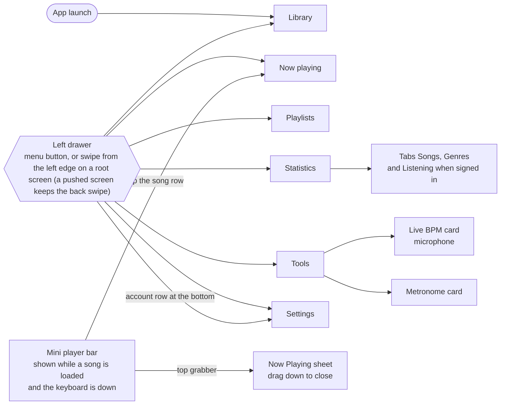

Sources: `ios/Sources/Views.swift` (`AppTab`, `RootView`, `MiniPlayer`),
`Drawer.swift`, `ToolsView.swift`, `StatisticsView.swift`.

### 1.2 Library, albums and the Add sheet

`LibraryHome` keeps the Songs list and the Albums grid alive side by side.
The "Songs | Albums" switch exists only when signed in. The iOS Library has no
Drafts mode; Drafts are web-only (section 2.2).

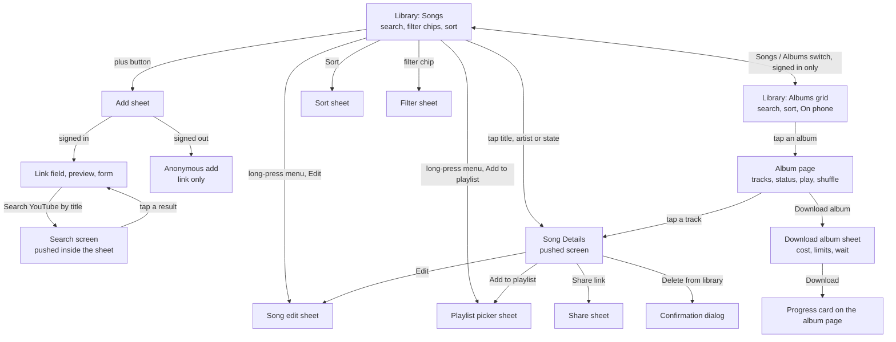

Sources: `AlbumsView.swift` (`LibraryHome`, `LibraryMode`), `LibraryView.swift`,
`AddSheet.swift`, `AnonAddSheet.swift`, `SearchView.swift`, `SongDetailsView.swift`,
`AlbumDetailView.swift` (`AlbumDownloadSheet`, `AlbumRunCard`), `SongEditView.swift`,
`PlaylistPickers.swift`, `ShareSheet.swift`, `LibrarySortSheet`/`LibraryFilterSheet`.

### 1.3 Now playing and Playlists

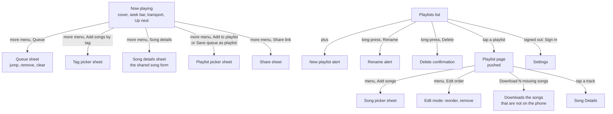

Sources: `PlaybackView.swift`, `PlaylistsView.swift`, `PlaylistDetailView.swift`,
`PlaylistPickers.swift`, `SongListScreen.swift`.

### 1.4 Signed in and signed out

"Signed in" means a Google or Apple session, or a legacy token saved by an old
build (`ServerLink.hasCredentials`). Signed out the app keeps a local library of
the songs on the phone and reads nothing from the server.

| Screen | Signed in | Signed out |
| --- | --- | --- |
| Library | Server catalog, Songs / Albums switch, chips "Never listened" and "Downloaded" | Phone songs only, no switch, no server catalog; empty state offers Add and Sign in |
| Add sheet | Link, preview, form, search by title | Link only, account-free download (`AnonAddSheet`) |
| Albums, album page | Yes | Not mounted |
| Playlists | List, page, create, edit | A "Sign in" button that opens Settings |
| Statistics | Songs, Genres, Listening | Songs, Genres on phone songs |
| Song edit, downloads from the server | Yes | Needs sign-in |
| Settings | Account card with Sign out, downloads, storage | Sign in with Apple and Google buttons, storage |
| Playback | From files on the phone | Same |

Sources: `LibraryView.swift`, `AlbumsView.swift`, `PlaylistsView.swift`,
`SettingsView.swift`, [`../specs/ios.md`](../specs/ios.md) (IOS-014, IOS-016a to IOS-016d).

## 2. Web

### 2.1 Routes

The router is `hashchange` in `web/js/app.js`. The sidebar groups Library
(Songs, Albums, Drafts), Now playing, Playlists, Genres map, Statistics, Studio,
a Help group (Music theory, About, Features) and Settings.

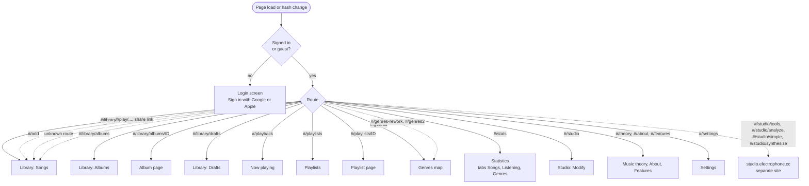

Behind the diagram:

- `#/play/...` opens the Library, then the "shared link" dialog, then Playback.
  `#/add` opens the Library and the Add dialog.
- On the first load a bare `#/library` jumps to the last used Library view
  (Songs, Albums or Drafts), kept in `localStorage`.
- Guests exist only when the server runs with `PUBLIC_VIEW=1`; they see a
  read-only Library and no Albums or Drafts menu items. By default a signed-out
  visitor sees only the login screen.
- `#/genres-classic` is a registered route with no menu link.
- After sign-in the app goes to `#/library`; Sign out lives in Settings, Account.

Sources: `web/js/app.js`, `nav-library.js`, `studio-redirect.js`, `share-hash.js`,
`login.js`, `signin.js`, `web/index.html`.

### 2.2 Dialogs from the Library

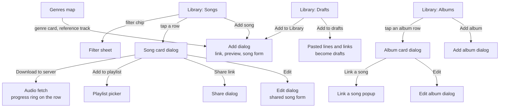

In the web, a tap on an album row opens the album card dialog. The Album page
(`#/library/albums/ID`) is reached by creating an album from a YouTube video
(section 4.3) or by its address; no list link points to it.

The Add dialog also accepts a YouTube playlist link (a list of videos to tick
and add) and a bare video id; an unsupported link shows its error under the
field. Add album is covered in section 4.3.

Sources: `web/js/library.js`, `add.js`, `add-preview.js`, `playlist-import.js`,
`song-card.js`, `edit-dialog.js`, `albums.js`, `drafts.js`, `genre-references.js`,
`lazy-ui.js`.

## 3. macOS app (ElectrophoneMac)

One window with a sidebar and a detail pane; the transport bar is pinned to the
bottom of the detail pane. It streams from the server and keeps no audio on the
Mac. The pages follow the web layout.

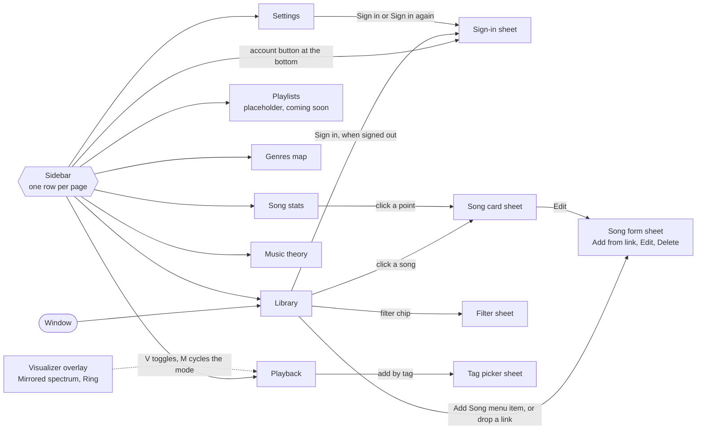

Menu shortcuts: Library `Cmd-1`, Playback `Cmd-2`, Settings `Cmd-,`, Add Song in
the File menu, Show or Hide Visualizer `V`. Tools (Live BPM, metronome) and the
Albums mode are iPhone features and are not in the Mac app.

Sources: `ios/MacSources/MacNavigation.swift`, `MacRootView.swift`, `MacSidebar.swift`,
`MacCommands.swift`, `MacSongFormSheet.swift`, `MacSignInSheet.swift`, `MacVisualizer.swift`,
`Pages/*.swift`, [`../specs/macos-gui.md`](../specs/macos-gui.md).

## 4. Key flows

### 4.1 Sign-in and signed out

iPhone:

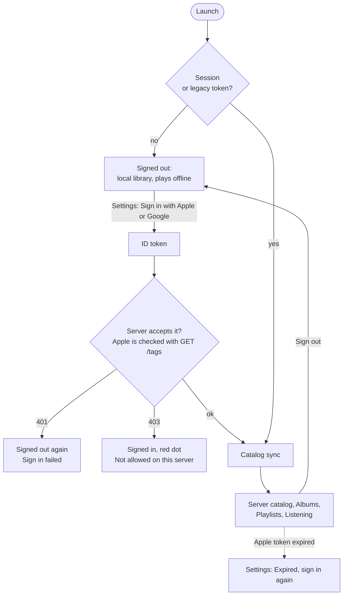

Web:

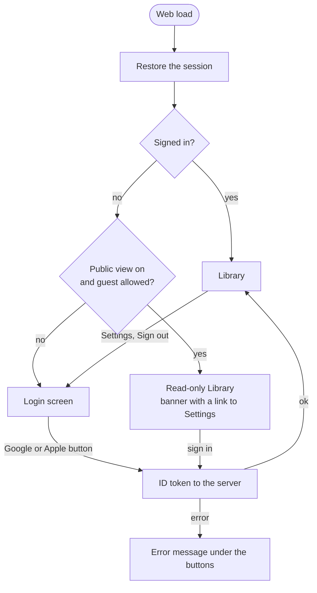

Sources: `ios/Sources/AuthService.swift`, `ServerLink.swift`, `SettingsView.swift`,
`web/js/app.js`, `login.js`, `signin.js`, `guest.js`.

### 4.2 Add a song

On iOS the song can be downloaded to the phone. On the web it is saved to the
catalog and the audio can be fetched to the server afterwards ("Download to
server", or Auto-download in Settings); the web never stores audio in the
browser.

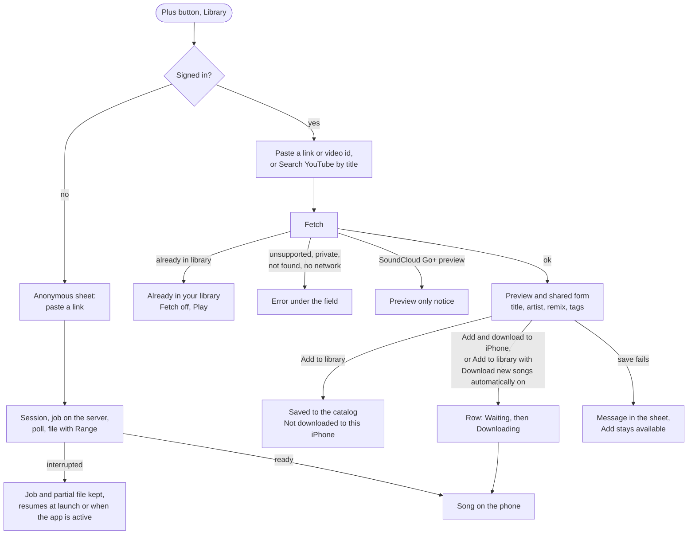

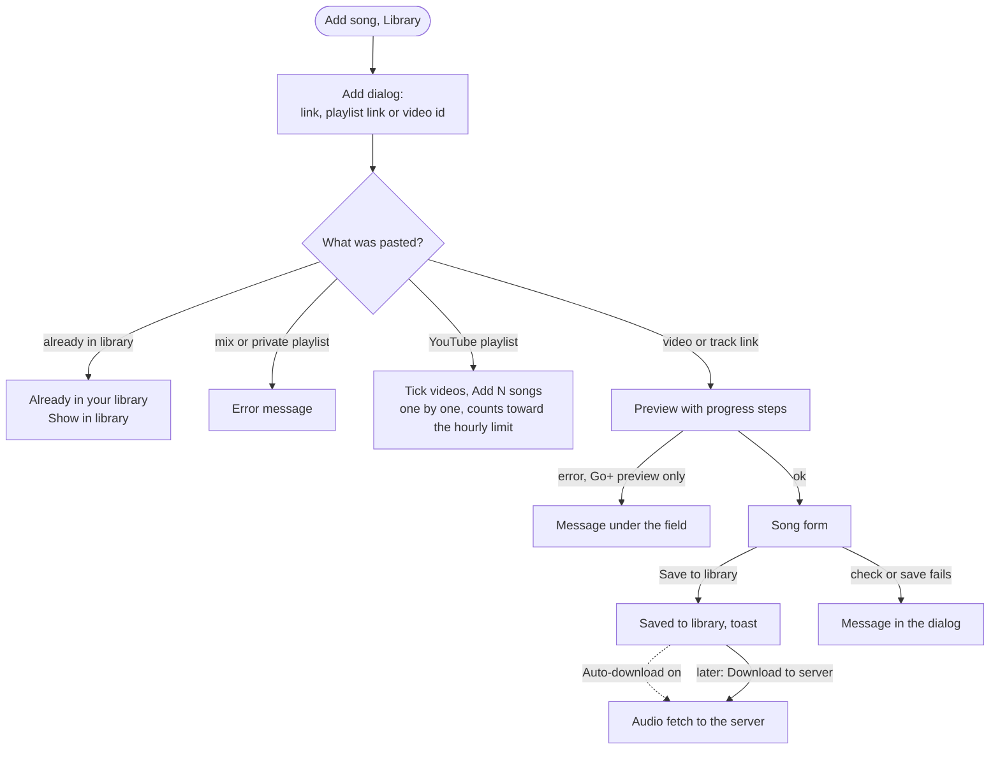

Sources: `ios/Sources/AddSheet.swift`, `AnonAddSheet.swift`, `AnonDownloader.swift`,
`ServerLink.swift`, `web/js/add.js`, `add-preview.js`, `playlist-import.js`,
`autodl.js`, [`journeys.md`](journeys.md).

### 4.3 Add an album

The Add album dialog (web, Library, Albums view) takes one address and routes
on its kind. Nothing is saved until Create.

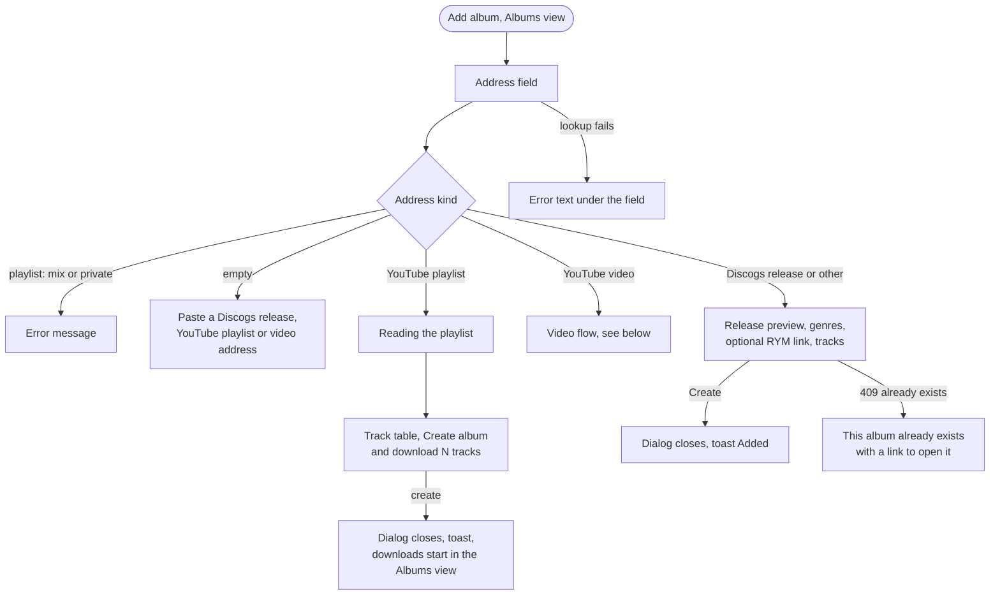

From a YouTube video: preview, edit the track list, create, split progress,
album page.

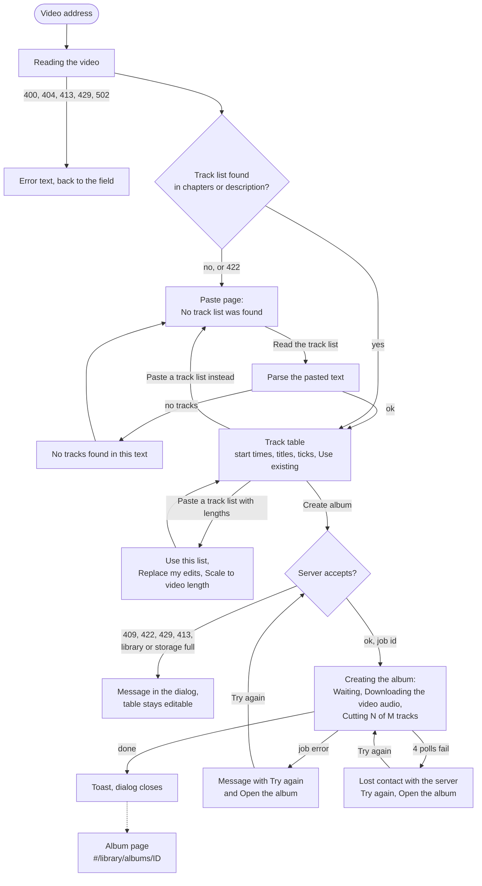

Sources: `web/js/albums.js` (`openAddAlbum`), `album-video.js`, `album-video-model.js`,
`album-video-progress.js`, `album-tracklist-panel.js`, `album-youtube-flow.js`,
`album-draft-view.js`.

## 5. States

### 5.1 A song's audio

What the iPhone Library row shows. "Server" is the audio file on Electrophone's
server; "phone" is `Documents/audio/<id>.m4a`. The phone state is never stored
as a flag: it is whether the file exists.

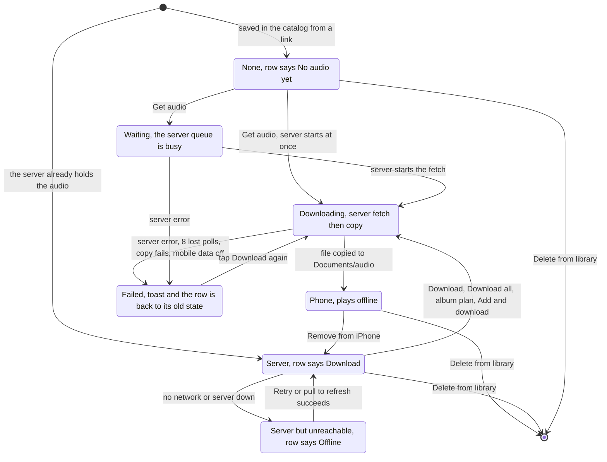

Notes read from the code:

- Downloading spans two stages: 0 to 80 percent is the server fetching the
  source (`GET /songs/{id}/audio`, then status polls), 80 to 100 percent is the
  copy to the phone (`GET /files/{id}` in a background session, so it continues
  while the app is suspended and finishes after a relaunch).
- A song that is on the phone but gone from the server's catalog stays as
  local-only: it plays, but cannot be downloaded again and has no Remove from
  iPhone.
- The web has three of these states in the Library row: no audio (a Download to
  server button), fetching (progress ring), and audio on the server (queue
  button). Its Download in the song card saves a file to the browser's download
  folder; that is not a state.
- Anonymous adds (signed out) go straight from a link to Phone and never pass
  through the server library.

Sources: `ios/Sources/LibrarySongRow.swift`, `ServerLink.swift`, `BackgroundDownloader.swift`,
`AnonDownloader.swift`, `AudioFiles.swift`, `web/js/library-rows.js`, `row-actions.js`,
`autodl.js`, [`../specs/ios.md`](../specs/ios.md) (IOS-035, IOS-106, IOS-107),
[`../specs/library.md`](../specs/library.md) (LIB-111, LIB-180).

### 5.2 Offline behaviour (iPhone)

Offline playback never depends on sign-in or on the server.

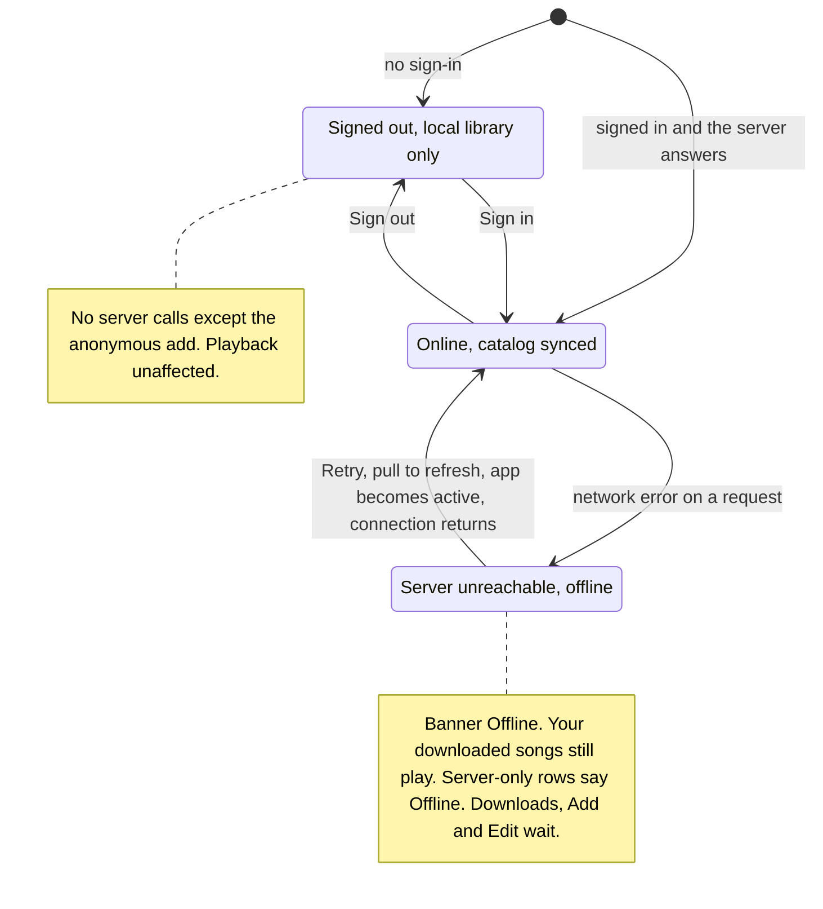

What keeps working with no connection, and what waits:

| Works offline | Waits for the server |
| --- | --- |
| Playing any downloaded song, lock-screen controls, queue, shuffle, repeat, resume after relaunch | Download, Get audio, Download album, Download missing songs |
| Library list, search, filters, sort and Song Details from the cached catalog (`library.json`, with `phone-index.json` as the offline index) | Adding or editing a song, playlists and albums (last answer is cached per account) |
| Finished plays are queued on disk (`plays/queue.json`) | Uploading plays: sent when a play ends, on pause, when the app is active, on sign-in and when connectivity returns |
| Interrupted anonymous downloads keep job and partial file | Continuing them: at launch, when active, and when the Add sheet opens, until the job expires |

The macOS app has no offline mode: it streams and stores no audio.

Sources: `ios/Sources/LibraryView.swift` (`offlineBanner`), `ServerLink.swift` (`reachable`,
`record`), `LibraryIndex.swift`, `PlaybackPersistence.swift`, `PlayQueue.swift`,
`BackgroundDownloader.swift`, `AnonDownloader.swift`,
[`../specs/ios.md`](../specs/ios.md) (IOS-016c, IOS-040, IOS-090, IOS-104, IOS-107).

## Not covered

- Settings contents (cards and fields), the Statistics and Genres map internals,
  Music theory, About, Features, and the standalone Studio site
  (studio.electrophone.cc).
- The visualizer and share-link screens beyond their entry points.
- Per-field validation, empty and loading states, toasts, and accessibility
  paths; error branches are shown only for the Add and Add album flows.
- The API and server job lifecycles (see [`../specs/api.md`](../specs/api.md)).
- The web "search YouTube by title" path in the Add dialog: the code supports a
  text query, but no screen passes one today.
- The hidden route `#/genres-classic` beyond its mention in section 2.1.
- Anything not yet in code: iOS Drafts and Artists modes, Mac Playlists.
- Whether any flow works on a real device: the diagrams show what the code
  does, not what has been run. See [`../specs/ios.md`](../specs/ios.md) for the
  status of each requirement.
